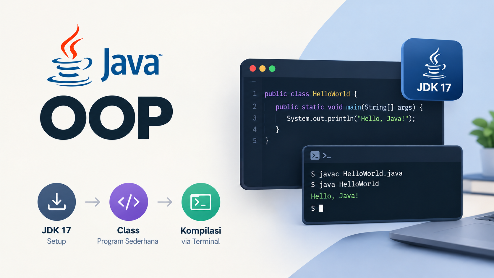

# Chapter 2

## Clone

```sh
git clone https://github.com/iguntur/oop-java-lecture.git
```

Setelah berhasil clone repository ini, selanjutnya masuk ke directory chapter-2

```sh
cd chapter-2
```

## Setup

### Common

Silahkan download dan install java JDK versi 17 disini, pilih salah satu dari provider:

- [Oracle JDK 17](https://www.oracle.com/asean/java/technologies/downloads/#java17)
- [Azul Zulu JDK 17](https://www.azul.com/downloads/?version=java-17-lts&package=jdk#zulu)
- [Temurin JDK 17](https://adoptium.net/temurin/releases?version=17&os=any&arch=any)

Download sesuai dengan jenis operating-system (eg. Linux, Windows, MacOS)
dan architecture (eg: x86, aarch64) type masing-masing.

### Nix

Jika menggunakan `Nix`, cukup jalankan perintah berikut untuk setup
java JDK dan environment path yang dibutuhkan.

```sh
devenv shell
```

## Development

Setelah mengaktifkan `devenv shell`, selanjutnya bisa mengikuti langkah berikut

### Build

```sh
javac -d target/classes/main src/main/java/id/guntur/Main.java
```

### Run

```sh
java -cp target/classes/main id.guntur.Main
```

## Watch Me on YouTube

<p align="center">
    <a href="https://youtu.be/CKtYQBi2wik" target="_blank" rel="noopener noreferrer">
        
    </a>
</p>
